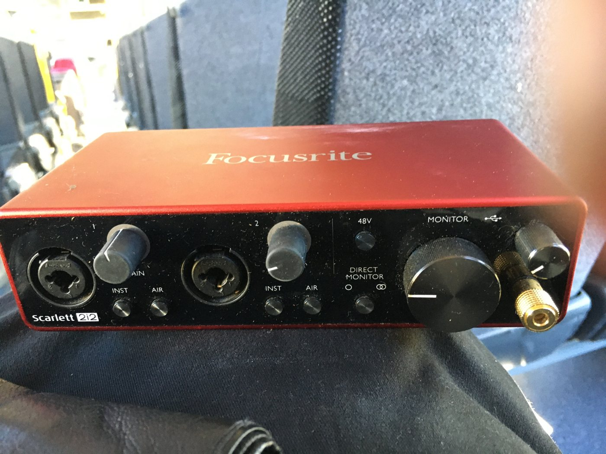

---
tags:
  - hardware
  - audio
  - tv
  - entertainment
---

# Audio & TV

## Panasonic 40" TV + Soundbar + Subwoofer

Currently used as a music player and for streaming TV shows.

| Component | Details |
|---|---|
| TV | Panasonic 40" |
| Audio | Soundbar + subwoofer |

### Connections

- [[laptops|ASUS headless laptop]] can connect via HDMI for a makeshift media center.
- [[desktop-x79|X79 server]] is connected over HDMI in the bedroom. It runs headless, so the TV is used for installs and recovery.

---

## Focusrite Scarlett 2i2 (3rd gen)

{ width="360" }

USB-C audio interface with two combo XLR/TRS inputs, 48V phantom power, Air mode on each input, direct monitoring and a headphone output (with a 3.5mm to 6.35mm adapter).

| Feature | Status |
|---|---|
| Interface | Working, runs on Linux with the stock kernel driver |
| Microphone | Missing |
| Guitar and cables | Missing |

---

## JBL Flip 5

Portable Bluetooth boombox, fully functional.

| Feature | Status |
|---|---|
| Bluetooth | Working |
| Battery | Working |

Used for portable audio around the workspace.
