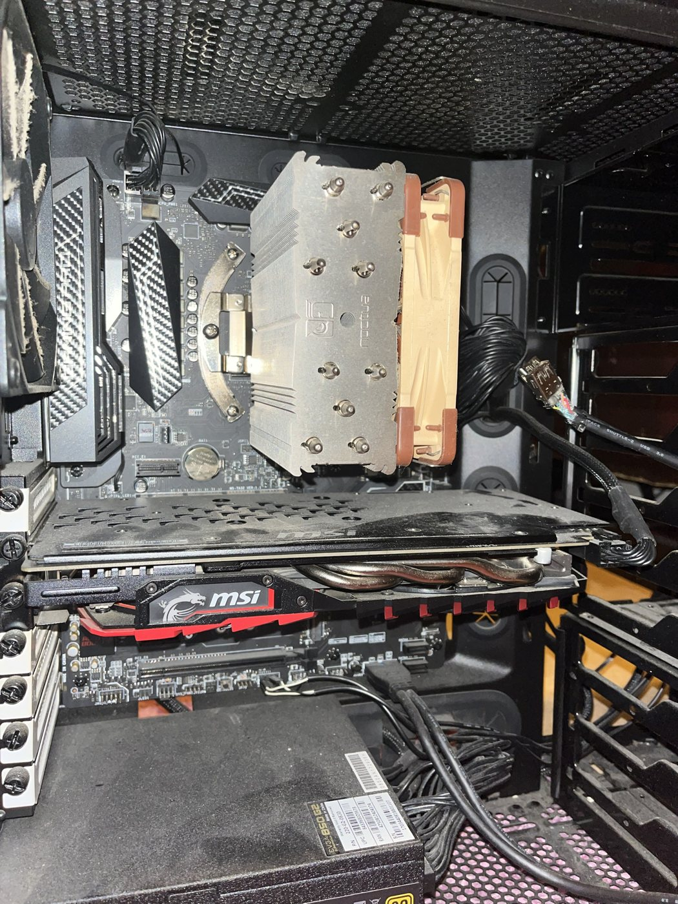
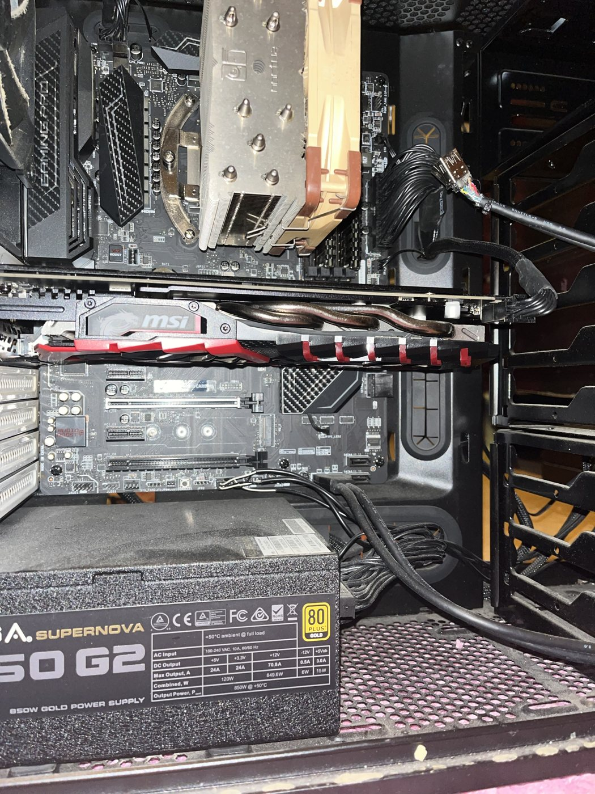
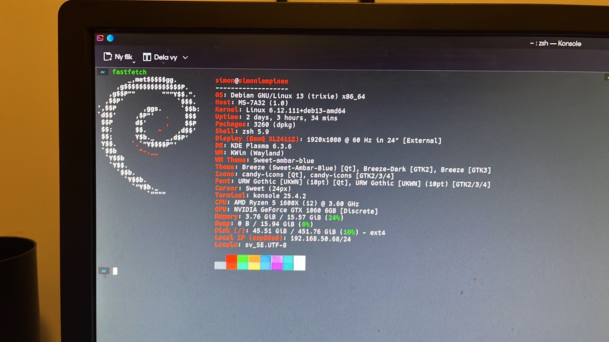

---
tags:
  - hardware
  - desktop
  - linux
  - debian
---

# X370 Desktop (Main Rig)

Daily driver since October 2026. It replaced the [[desktop-x79|X79]], which is now the home server.

{ width="340" }
{ width="340" }

## Specs

| Component | Details |
|---|---|
| Motherboard | MSI X370 Gaming Pro Carbon (MS-7A32) |
| CPU | AMD Ryzen 5 1600X (6C/12T, 3.6 GHz) |
| Cooler | Noctua single-tower air cooler |
| GPU | MSI GTX 1060 6GB Gaming X |
| RAM | 16GB DDR4 |
| Storage | ~500GB M.2 NVMe (moved over from the X79), ext4 |
| PSU | EVGA SuperNOVA 850 G2 (80+ Gold) |
| Display | BenQ XL2411Z 24" 1080p, used while the MSI 165Hz monitor is lent out |
| OS | Debian 13 (trixie), kernel 6.12, KDE Plasma 6.3 on Wayland, zsh |
| Network | `enp30s0`, 192.168.50.68 |

{ width="520" }

## Storage

The board has two M.2 slots. One holds the system NVMe and the other is free. Candidates for the free slot:

- **256GB M.2 with a working Windows 10 install.** Keep it for games that need Windows and pick it from the BIOS boot menu (F11) instead of setting up a GRUB dual boot. Windows 10 is out of support, so use it for games only.
- **500GB M.2, contents unknown.** Mount it read-only first and look at what is on it before wiping anything.

Check whether each drive is NVMe or M.2 SATA before installing it. Which slot supports which, and which SATA ports it disables, is in the board manual.

## To Do

- [ ] Check the RAM speed (`sudo dmidecode -t memory | grep -i speed`) and turn on A-XMP if it runs at 2133
- [ ] Clean the dust out of the rear fan, GPU and PSU
- [ ] DHCP reservation for 192.168.50.68 on the router
- [ ] Confirm Tailscale is installed and the machine shows up on the tailnet
- [ ] Get the MSI 165Hz monitor back

## Upgrade Path

The plan is a Ryzen 5 5600 on the unopened [[b550-build|B550 board]]. When that happens the X370 board and the 1600X become spare parts and are a candidate for the next home server, see the [Homelab Roadmap](../homelab/roadmap.md).
