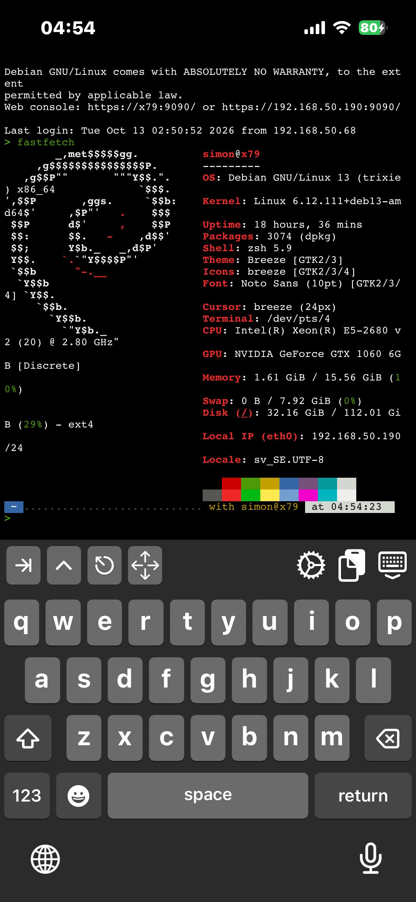

---
tags:
  - hardware
  - server
  - linux
  - debian
  - homelab
---

# X79 Server

Former main desktop. Since October 2026 it is the home server, and the [[desktop-x370|X370 rig]] is the daily driver. It has no monitor of its own: it is used over SSH and the Cockpit web console, and its HDMI output goes to the bedroom TV when it needs a screen.

{ width="300" }

## Specs

| Component | Details |
|---|---|
| Case | Dutzo, with ARGB fan lighting (see [[microcontrollers]]) |
| Motherboard | ASUS X79 DELUXE |
| CPU | Intel Xeon E5-2680 v2 (10C/20T, 2.8 GHz, no AVX2) |
| GPU | MSI GTX 1060 6GB Gaming X (secondhand, ~483 kr) |
| RAM | 16GB DDR3, mixed Corsair Dominator and Crucial Ballistix, running at 1333MHz (no XMP) |
| Boot drive | 128GB SATA SSD (taken from the [Acer laptop](laptops.md#acer-laptop)) |
| Storage | 300GB SATA drive |
| OS | Debian 13 (trixie), kernel 6.12 |
| Network | `eth0`, 192.168.50.190, Wake-on-LAN set up |

## Running Now

- Jellyfin
- Cockpit web console on port 9090

## Plan

Docker first, Proxmox later. The machine has a 128GB boot drive and 16GB of RAM, so virtual machines would use up the headroom for no real gain right now. Proxmox is a better fit on the Ryzen box that frees up after the [[b550-build|B550 upgrade]]. A few modern container images assume AVX2, which this CPU lacks, so check an image before pulling it.

- [ ] Install Docker Engine and the Compose plugin
- [ ] Move Jellyfin into Compose, with NVENC transcoding on the GTX 1060
- [ ] Bring Pi-hole back as a container
- [ ] Uptime Kuma, and a Samba share for the iPhone Files app
- [ ] Backups to the second drive plus an offsite copy
- [ ] Measure the idle power draw with a wall plug meter

The full order of work is in the [Homelab Roadmap](../homelab/roadmap.md). Network layout is on [[network]].

## History

- Built from secondhand parts (~1,000–1,500 SEK in total).
- Ran Windows 10 first, then CachyOS, then Debian 13 with KDE (September 2026).
- Installed the GTX 1060 and cleared the AMD-to-NVIDIA driver conflicts.
- Settled on DDR3-1333 (no XMP) after mixing the Corsair and Crucial kits.
- Fixed an NVIDIA persistence boot error by turning Secure Boot off.
- Ran Ollama on the 1060.
- October 2026: the NVMe moved to the X370 rig, the Acer's 128GB SSD became the boot drive, and this machine became the server.
