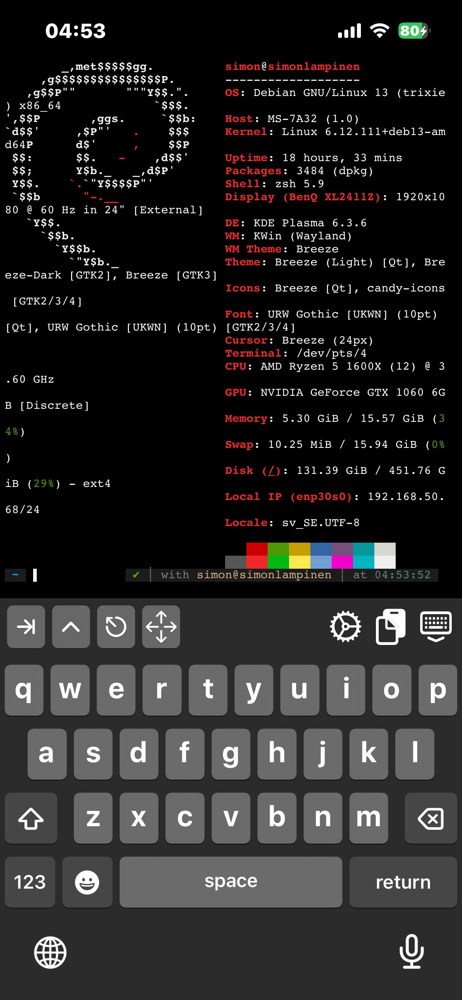
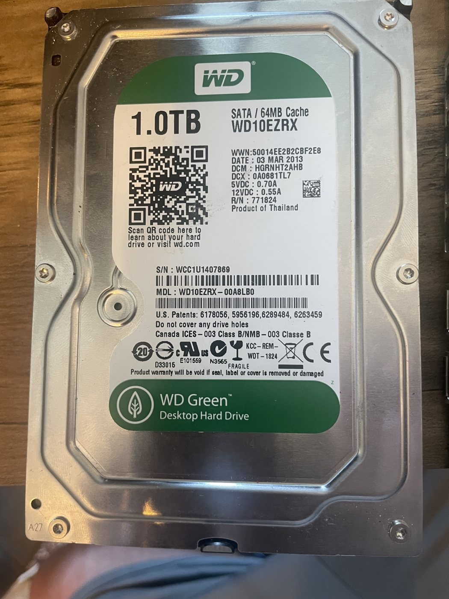
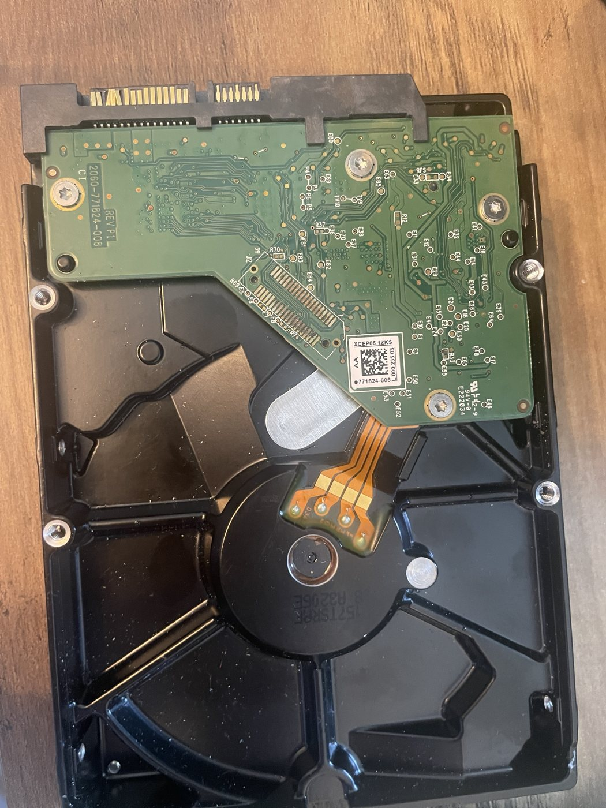
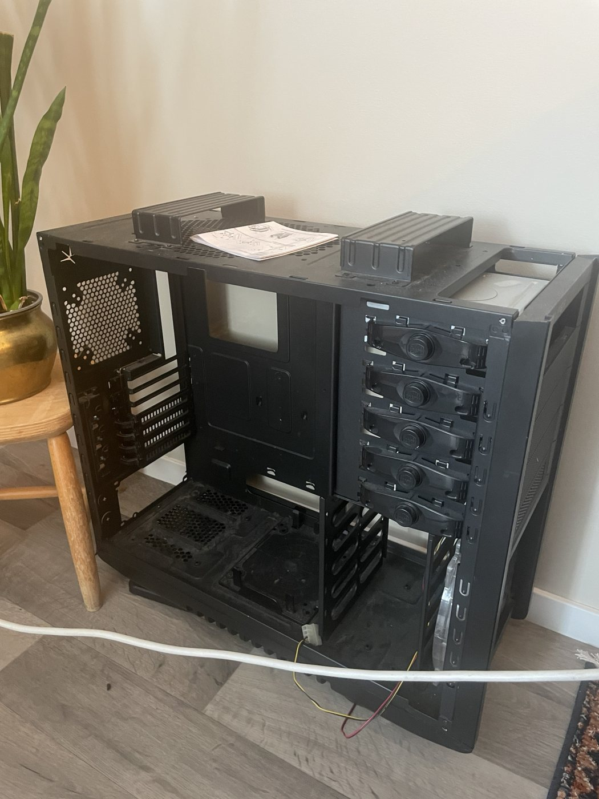

---
tags:
  - hardware
  - photos
---

# Photo Gallery

Photos of the hardware, October 2026. Files are in `docs/assets/devices/`. A folder for workspace and desk photos is in `docs/assets/workspace/`.

## Main Rig (X370)

{ width="320" }
{ width="320" }

{ width="520" }

Details: [[desktop-x370]]

## Remote Access From the iPhone

SSH into both desktops from the iPhone with the iSH app, over Tailscale.

{ width="260" }
{ width="260" }

The hostnames, usernames and local IP addresses are visible in these screenshots.

## Audio Interface

{ width="420" }

Details: [[audio-tv]]

## Arduino

{ width="320" }

Details: [[microcontrollers]]

## WD Green 1TB

{ width="260" }
{ width="260" }

Details: [[salvage-pcbs]]

## Spare Case

{ width="320" }

Currently unused.
