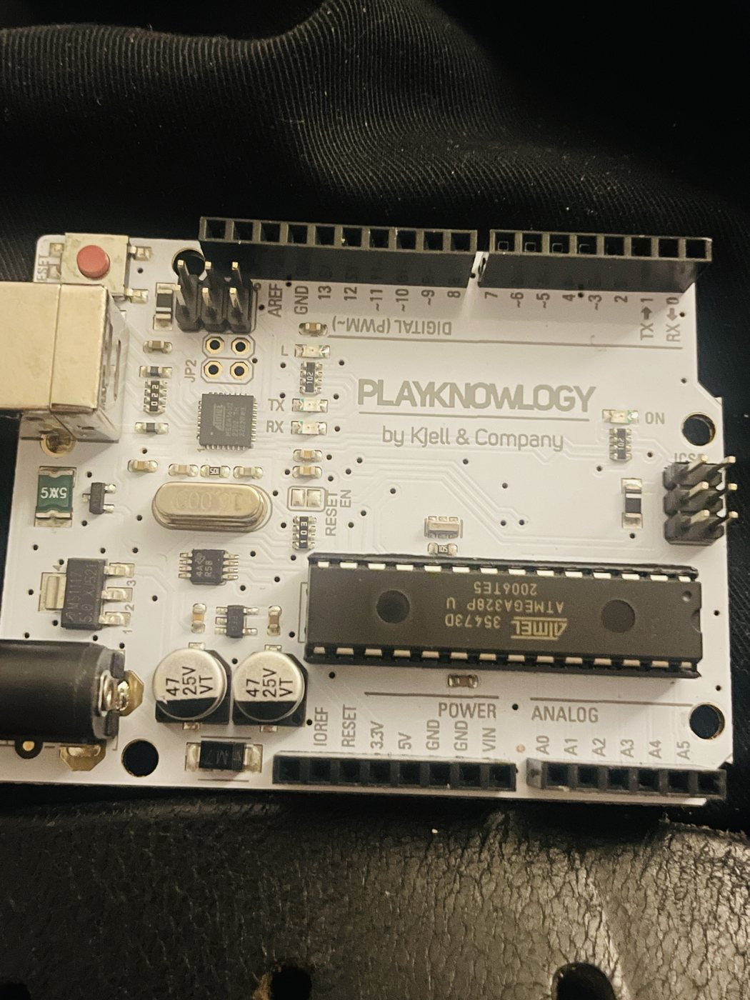

---
tags:
  - hardware
  - arduino
  - firmware
  - tools
  - soldering
---

# Microcontrollers & Tools

## Arduino Uno R3 (Playknowlogy by Kjell & Company)

{ width="320" }

Uno-compatible board with an ATmega328P and an ATmega16U2 as the USB chip. Drives the ARGB fan lighting in the [[desktop-x79|Dutzo case]] on the X79 build.

| Setting | Value |
|---|---|
| Library | FastLED |
| LED type | WS2812B |
| Color order | GRB |
| Data pin | 6 |

**Status:** Complete.

---

## ST-Link V2

STM32 USB programmer / flasher.

### Used For
- [[scooter|Xiaomi e-scooter]] BLE dashboard firmware flashing
- General STM32 debugging and flashing

---

## Jeverty PSU — 30V 10A

Brand new bench power supply for the homelab.

### Use Cases
- Phone repair (powering boards without batteries)
- Arduino / e-scooter testing
- General electronics prototyping

---

## Soldering Station

| Item | Count / Details |
|---|---|
| Soldering irons | 3x |
| Flux | Available |
| Solder (tin) | Available |
| Isopropyl alcohol | Available |

Used for board-level repair and salvage work — see [[salvage-pcbs]].

---

## Cables & Prototyping

- Dupont cables (multiple)
- Various connectors and jumpers

---

*Add future MCU projects here (ESP32, sensor nodes for the home-lab camera project, etc.) as they
come up.*
